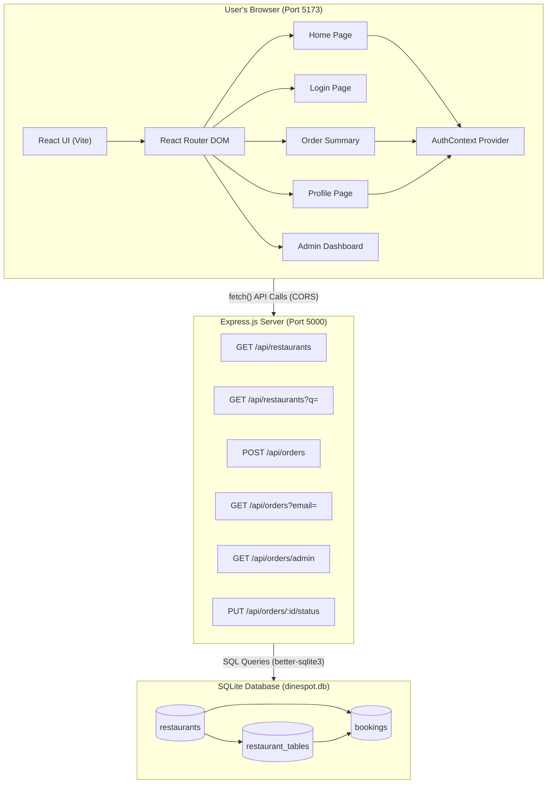
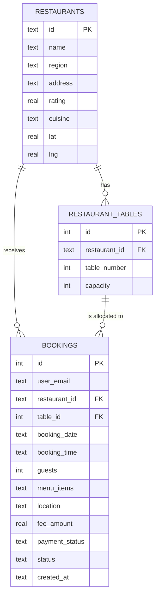
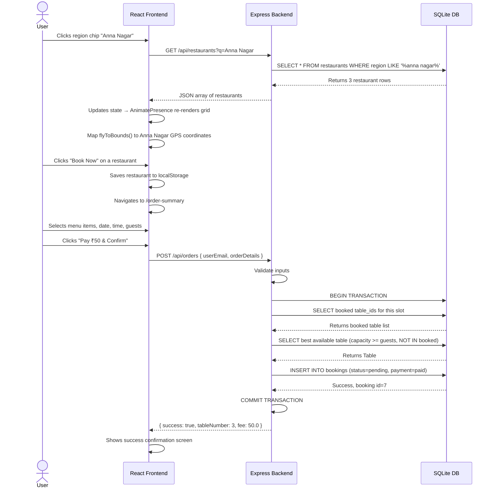
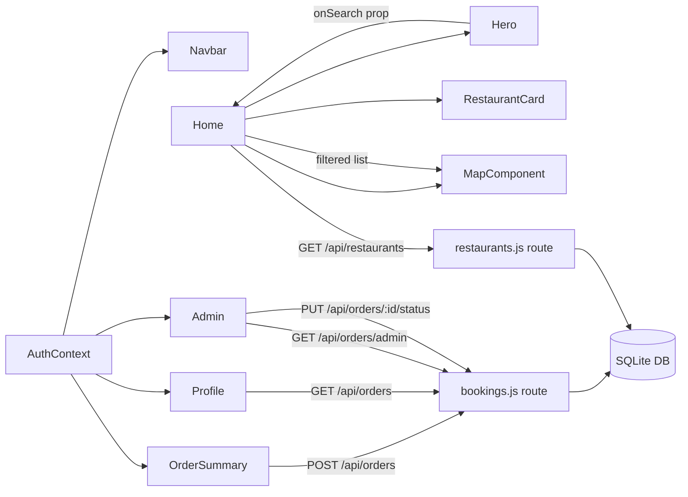
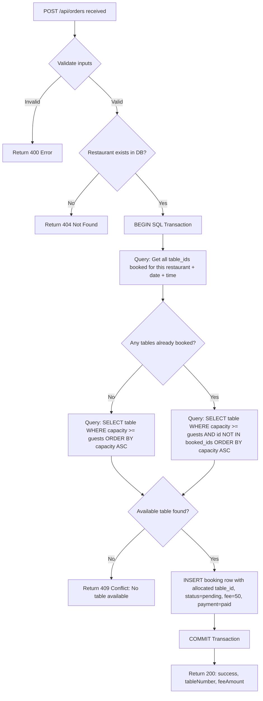
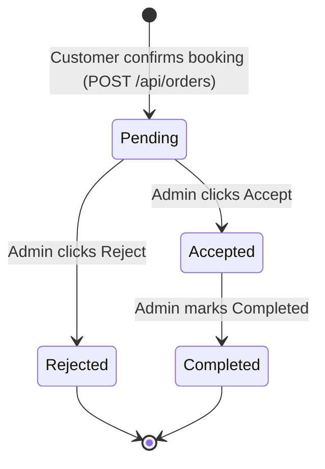

# DineSpot: Architecture Diagrams & Visual Reference
**Supplement to Comprehensive_Project_Info.md**

---

## 1. Full Folder / File Structure

```
Restaurant Pre-Booking Website/
│
├── frontend/                         ← React Application (Vite)
│   └── src/
│       ├── main.jsx                  ← Entry point, wraps app in AuthProvider
│       ├── App.jsx                   ← Route definitions
│       ├── index.css                 ← Global design tokens (colors, fonts)
│       │
│       ├── context/
│       │   └── AuthContext.jsx       ← Global user session state (login/logout)
│       │
│       ├── components/               ← Reusable UI components
│       │   ├── Navbar.jsx / .css     ← Top navigation (links to profile, admin, logout)
│       │   ├── Hero.jsx / .css       ← Landing section with search + region chips
│       │   ├── RestaurantCard.jsx    ← Individual restaurant display card
│       │   └── MapComponent.jsx      ← Leaflet interactive map
│       │
│       └── pages/                    ← Full-page views (1:1 with routes)
│           ├── Home.jsx / .css       ← Discovery page, search results grid
│           ├── Login.jsx / .css      ← Login & Register forms
│           ├── OrderSummary.jsx/.css ← Menu selection + booking form + fee
│           ├── Profile.jsx / .css    ← User booking history
│           └── Admin.jsx / .css      ← Hotel admin dashboard
│
├── backend/                          ← Node.js / Express Server
│   ├── server.js                     ← App entry, middleware, route mounting
│   ├── data.js                       ← Source of truth for restaurant seed data
│   ├── package.json
│   │
│   ├── database/
│   │   ├── database.js               ← SQLite connection, schema, WAL pragma
│   │   └── dinespot.db               ← The actual SQLite database file
│   │
│   ├── seed/
│   │   └── seedRestaurants.js        ← Idempotent seeder (runs once on startup)
│   │
│   └── routes/
│       ├── restaurants.js            ← GET endpoints for restaurant data
│       └── bookings.js               ← POST/GET/PUT endpoints for reservations
│
├── PPT_Content.md                    ← Slide content for review presentation
├── Comprehensive_Project_Info.md     ← This document
└── legacy/                           ← Original HTML/CSS/JS prototype
    └── index.html
```

---

## 2. System Architecture Diagram



---

## 3. Entity-Relationship (ER) Diagram



---

## 4. Application Data Flow Diagram



---

## 5. Module Dependency Map



---

## 6. Table Allocation Algorithm (Flowchart)



---

## 7. Booking Status Lifecycle



---

## 8. Page Route Map

| URL Path | Component | Access | Purpose |
|---|---|---|---|
| `/` | `Home.jsx` | Public | Restaurant discovery, search, region filter |
| `/login` | `Login.jsx` | Public | Login / Register / Guest access |
| `/order-summary` | `OrderSummary.jsx` | Logged-in Users | Menu selection, reservation form, fee payment |
| `/profile` | `Profile.jsx` | Logged-in Users | View personal booking history + status |
| `/admin` | `Admin.jsx` | Unrestricted* | Hotel management – accept/reject/complete |

> *In a production app, `/admin` would be protected with role-based authentication.

---

## 9. Key React Components Summary

| Component | File | Role |
|---|---|---|
| `AuthContext` | `context/AuthContext.jsx` | Global user state, login/logout |
| `Navbar` | `components/Navbar.jsx` | Navigation, profile/admin links |
| `Hero` | `components/Hero.jsx` | Search bar, animated region chips |
| `RestaurantCard` | `components/RestaurantCard.jsx` | Individual restaurant UI with "Book Now" |
| `MapComponent` | `components/MapComponent.jsx` | Leaflet map + flyTo animation |
| `Home` | `pages/Home.jsx` | Orchestrator for search + grid + map |
| `Login` | `pages/Login.jsx` | Auth forms |
| `OrderSummary` | `pages/OrderSummary.jsx` | Menu, booking form, fee display |
| `Profile` | `pages/Profile.jsx` | User order history dashboard |
| `Admin` | `pages/Admin.jsx` | Hotel-side reservation management |

---

## 10. Backend API Code Reference

### Restaurant Search (GET)
```js
// routes/restaurants.js
router.get('/', (req, res) => {
  const { q } = req.query;
  if (q) {
    const rows = db.prepare(
      `SELECT * FROM restaurants WHERE region LIKE ? OR name LIKE ? OR cuisine LIKE ?`
    ).all(`%${q}%`, `%${q}%`, `%${q}%`);
    return res.json(rows);
  }
  res.json(db.prepare('SELECT * FROM restaurants').all());
});
```

### Table Allocation Algorithm (POST)
```js
// routes/bookings.js - The core algorithm
const bookedRows = db.prepare(
  `SELECT table_id FROM bookings
   WHERE restaurant_id = ? AND booking_date = ? AND booking_time = ?
   AND status != 'cancelled'`
).all(restaurantId, date, time);

const bookedIds = bookedRows.map(b => b.table_id);

// Conditional: choose correct query based on whether tables are booked
let availableTable;
if (bookedIds.length === 0) {
  availableTable = db.prepare(
    `SELECT * FROM restaurant_tables
     WHERE restaurant_id = ? AND capacity >= ?
     ORDER BY capacity ASC LIMIT 1`
  ).get(restaurantId, guests);
} else {
  const placeholders = bookedIds.map(() => '?').join(',');
  availableTable = db.prepare(
    `SELECT * FROM restaurant_tables
     WHERE restaurant_id = ? AND capacity >= ?
     AND id NOT IN (${placeholders})
     ORDER BY capacity ASC LIMIT 1`
  ).get(restaurantId, guests, ...bookedIds);
}
```
